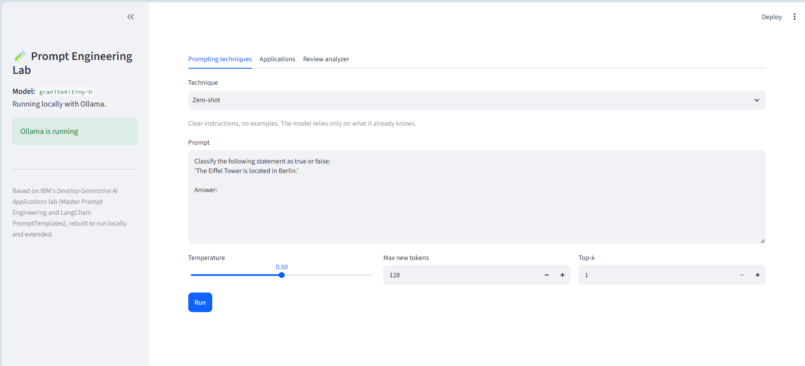
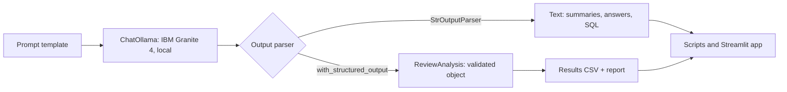

# Prompt Engineering with LangChain & IBM Granite, running locally


> Based on IBM's **"Master Prompt Engineering and LangChain PromptTemplates"** lab
> (course 1 of the *Develop Generative AI Applications* series on Coursera),
> rebuilt to run **fully locally and free** on IBM Granite via Ollama, and extended
> into a small review-analysis tool with structured output and a web demo.




## What this project covers

Every lab section is a standalone script, plus three extensions:

| Lab objective | Where it's implemented |
|---|---|
| Basics of prompt engineering | `scripts/01_basic_prompt.py` |
| Zero-, one- and few-shot prompting | `scripts/02_zero_shot.py`, `03_one_shot.py`, `04_few_shot.py` |
| Chain-of-thought and self-consistency | `scripts/05_chain_of_thought.py`, `06_self_consistency.py` |
| LangChain prompt templates and LCEL chains | `scripts/07_prompt_template.py`, `src/promptlab/chains.py` |
| Practical LLM applications (summarization, QA, classification, SQL, role play) | `scripts/08_applications.py`, `09_role_playing.py` |
| Exercise 5: product review analyzer | `scripts/10_review_analyzer.py` |
| **Extension:** review analysis tool with structured output | `scripts/11_review_report.py`, `src/promptlab/review_analyzer.py` |
| **Extension:** interactive web demo | `app.py` (Streamlit) |
| **Extension:** automated tests + CI | `tests/`, `.github/workflows/tests.yml` |

All 4 exercises in the lab are solved with my own examples.

## What's different from the original lab

**Changed to run locally (no cloud account, no cost)**
- IBM watsonx.ai → **Ollama**, running the same model family (IBM Granite 4) on a consumer GPU.
- Jupyter notebook → a Python package (`src/promptlab`) plus standalone scripts.
- Outdated pinned libraries (LangChain 0.2) → current versions (LangChain 1.x), managed with `uv`.

**Improvements on the lab code**
- **Real self-consistency:** the lab asks for three solutions in a single response, so they aren't independent. Here the model is sampled several times separately and the final answer is chosen by majority vote, as in the original technique.
- **Simpler, safer LCEL chains:** the lab wraps templates in `RunnableLambda(format_prompt)`, which reads a global `prompt` variable that is reassigned in every section. Templates are now piped directly (`prompt | llm | parser`).
- **Chat roles for role play:** the persona goes in a *system* message instead of being mixed into one prompt string.
- **Generation parameters actually applied:** in the lab's Skills Network helper, the `params` argument was accepted but never used.
- **Clearer templates:** instruction, input and answer slot are separated, and each prompt states the expected output format.

**Extended Exercise 5 into a usable tool**
- Reads reviews from any CSV file.
- Returns **validated structured output** (Pydantic schema + Ollama's JSON-schema mode): sentiment, features, summary.
- Retries invalid answers, logs failures without stopping, and writes a results CSV and a Markdown report (sentiment shares, most mentioned features, most common complaints).

## How it works



`src/promptlab/` holds the logic once; the scripts, the web app and the tests all reuse it.

## Project structure

```
prompt-engineering-lab/
├── src/promptlab/
│   ├── llm.py               # LangChain ↔ Ollama connection (replaces WatsonxLLM)
│   ├── chains.py            # prompt templates + LCEL chains for each application
│   ├── techniques.py        # technique examples + real self-consistency
│   ├── review_analyzer.py   # structured review analysis + report
│   └── utils.py
├── scripts/                 # one script per lab section (00–11)
├── data/sample_reviews.csv  # 20 sample product reviews
├── tests/                   # unit tests (fake model, no Ollama needed)
├── app.py                   # Streamlit demo
└── pyproject.toml           # dependencies (managed with uv)
```

## Quick start

**Requirements:** [Ollama](https://ollama.com) and [uv](https://docs.astral.sh/uv/). Tested on Windows 11 with a GTX 1660 Ti (6 GB) and 16 GB RAM.

```bash
# 1. Download the model (about 4 GB, once)
ollama pull granite4:tiny-h

# 2. Get the code and install dependencies
git clone https://github.com/hlmhlr/prompt-engineering-lab.git
cd prompt-engineering-lab
uv sync

# 3. Optional: copy the settings file to change the model
cp .env.example .env        # Windows PowerShell: copy .env.example .env

# 4. Check everything works
uv run python scripts/00_check_setup.py
```

### Run the lab scripts

```bash
uv run python scripts/02_zero_shot.py
uv run python scripts/06_self_consistency.py
uv run python scripts/09_role_playing.py       # interactive, type 'quit' to exit
```

### Analyze reviews

```bash
uv run python scripts/11_review_report.py                              # sample data
uv run python scripts/11_review_report.py --input my_reviews.csv --limit 50
```
Results are saved to `outputs/review_results.csv` and `outputs/review_report.md`.

### Web demo

```bash
uv run streamlit run app.py
```

### Tests

```bash
uv run pytest
```

## Results


**Speed:** about 1.05 seconds per review on a GTX 1660 Ti with `granite4:tiny-h`.

**Self-consistency** (question: *"When I was 6, my sister was half my age. Now I am 70, how old is my sister?"*, correct answer 67):

| Method | Result |
|---|---|
| Single answer | 67 correct |
| Majority vote over 5 samples | 67, 3/5 samples agree |

**Review analysis of the 20 sample reviews:**


# Review Analysis Report

- Reviews analyzed: **20**
- Model: `granite4:tiny-h` (local, via Ollama)

## Sentiment

| Sentiment | Reviews | Share |
|---|---|---|
| positive | 8 | 40% |
| negative | 7 | 35% |
| neutral | 5 | 25% |

## Most mentioned features

| Feature | Mentions |
|---|---|
| battery life | 7 |
| customer service | 3 |
| keyboard | 2 |
| screen | 2 |
| display | 2 |

## Most mentioned in negative reviews

| Feature | Mentions |
|---|---|
| battery life | 3 |
| customer service | 2 |
| screen | 2 |
| speed | 1 |
| stability | 1 |

## Limitations

- A small local model (1B active parameters) is fast but makes more mistakes than large cloud models, especially on multi-step reasoning.
- Feature names extracted by the model aren't always consistent ("battery" vs "battery life"), which splits the counts. A fixed list of allowed features would fix this.
- The role-play bot has no conversation memory: each question is answered on its own, as in the original lab.
- The model switch is one line in `.env`, but only Ollama models are supported. Other providers would need their LangChain integration in `llm.py`.

## What I learned

- Zero-, one-, and few-shot prompting give the model progressively more examples, and each example shapes the output format as much as the content. Asking for step-by-step reasoning (chain-of-thought) helps on multi-step problems, and naming the exact steps works better than a generic “think step by step.”
- Generation parameters control behavior: `top_k=1` makes output predictable, a low token limit forces short answers, and temperature 0 makes extraction repeatable.
- Building composable LangChain pipelines with LCEL chains. These chains build pipelines from small parts that can be swapped or reused.
- Stating the output format explicitly is part of prompt engineering and a schema (Pydantic + structured output) gives validated data that code can count and save, instead of free text to parse.
- LLM calls can fail or return invalid output, so real pipelines need retries and must log failures without stopping. And telling the model to answer “only from the context” and to admit when it’s unsure is the basic idea behind RAG.
- Running open models locally with Ollama removes API costs, and testing the LLM code without the model by using a fake model with scripted answers.

## Acknowledgments and references

- Original lab: **"Master Prompt Engineering and LangChain PromptTemplates"** by Hailey Quach, Kang Wang and Faranak Heidari, IBM Skills Network, part of the *Develop Generative AI Applications: Get Started* course on Coursera. © IBM Corporation. This repository is an independent re-implementation, and only a few short example texts from the lab are reused.
- [IBM Granite 4 models](https://www.ibm.com/granite/docs/models/granite)
- [LangChain documentation](https://python.langchain.com/)
- [Ollama](https://ollama.com)
- Wang et al. (2022), [*Self-Consistency Improves Chain of Thought Reasoning in Language Models*](https://arxiv.org/abs/2203.11171)
- Wei et al. (2022), [*Chain-of-Thought Prompting Elicits Reasoning in Large Language Models*](https://arxiv.org/abs/2201.11903)

## License

MIT, see [LICENSE](LICENSE). Applies to the code in this repository only.
